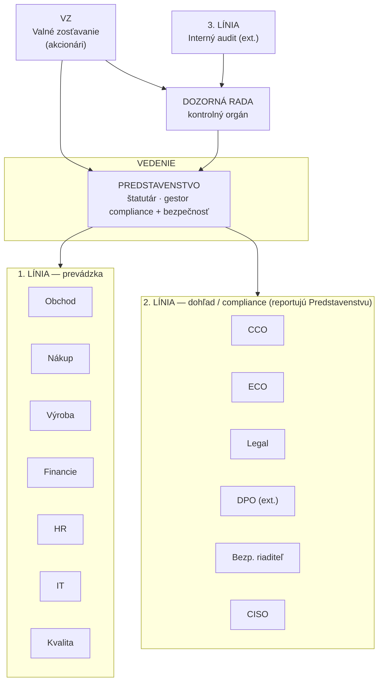
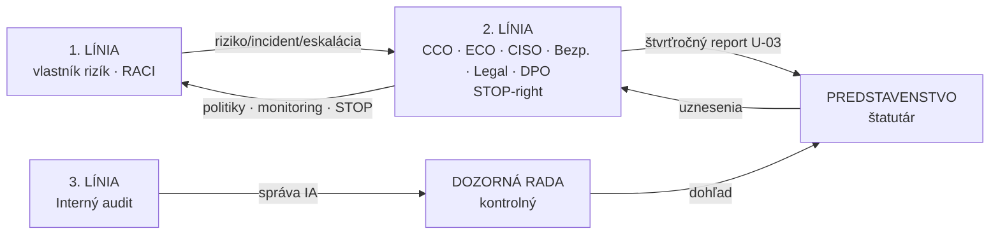

# IOTA Defence a.s. — Organizačná štruktúra & reporting (Org-Chart)

Vizualizácia org-struktúry. Primárny artefakt: **interaktívny Archify diagram** (`iota-org-tree-archify.html` — zoom/search/chapters, dark+light téma, PNG export). Alternatíva: Mermaid (`org-structure-A.png`, `org-reporting-B.png`). Zdroj: FC-01 z pričinok (NÁVRH v1.0, 6.10.2026).

> **Archify skill** (tt-a1i/archify v3.2) inštalovaný cez `npx skills add tt-a1i/archify -g`. Candidate: `iota-org-tree.candidate.json`; render: `iota-org-tree-archify.html` (all 4 gates pass, SHA-256 receipt v `.archify/`).

---

## A) Org-Tree — čistá verzia

---

## B) Reporting & rozhodovacie väzby (čisté)

---

**Pravidlo kumulácie (FC-02):** 1.+2. línia u jednej osoby → STOP (výnimka: Predstavenstvo). Gestor nesmie zodpovedať za predaj. CISO oddelený od IT prevádzky.

---
IOTA Defence a.s. · 02-ORG-VIZ · NÁVRH v1.0 · 22.10.2026 · Interné – Dôverné