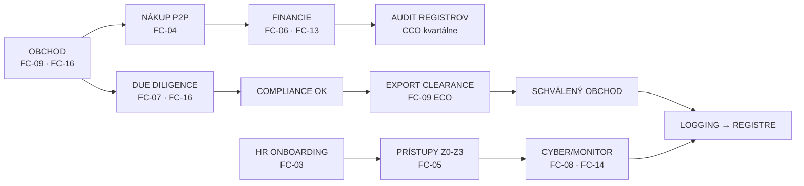

# WORKFLOWS — Kompletný procesný katalóg

**IOTA Defence a.s. · Vlastník: CEO · Spravuje: CCO · Klasifikácia: Interné – Dôverné · Stav: NÁVRH v1.1 (22.10.2026)**

Každý proces má: **Workflow ID** (FC-nn) → **RACI** → **Log** → **Overenie (KPI)**. Bez workflow + logu sa proces nevykonáva.

> **Kompletná mapa procesov + gap analýza:** `00-PROCESS-MAP-GAP.md`
> **Prevádzkové doplnky FC-17..FC-24:** `FC-17-24-operacne-procesy.md` (text) + separátne Archify diagramy.

---

## INDEX PROCESOV (24 záväzných — FC-01..FC-24)

| ID | Proces | Lead | Diagram (Archify HTML) | Stav |
|:--|:--|:--|:--|:--|
| FC-01 | Org štruktúra & reporting | CEO | iota-org-tree-archify.html | ✅ |
| FC-02 | Tri línie ochrany | CCO | fc02-tri-linie-archify.html | ✅ |
| FC-03 | Onboarding & prístupy | HR+CISO | fc03-onboarding-archify.html | ✅ |
| FC-04 | Nákup P2P | Financie | fc04-nakup-archify.html | ✅ |
| FC-05 | Dátové zóny & prístup | CISO | fc05-datove-zony-archify.html | ✅ |
| FC-06 | Platba agentovi | CFO+CCO | fc06-platba-agentovi-archify.html | ✅ |
| FC-07 | Due diligence partnera | CCO | fc07-dd-partnera-archify.html | ✅ |
| FC-08 | Incident response | CISO | fc08-incident-archify.html | ✅ |
| FC-09 | Sankcie & export control | ECO | fc09-export-control-archify.html | ✅ |
| FC-10 | Whistleblowing | zodp. osoba | fc10-whistleblowing-archify.html | ✅ |
| FC-11 | Dar & pohostenie | CCO | fc11-dar-archify.html | ✅ |
| FC-12 | Konflikt záujmov | CCO | fc12-konflikt-archify.html | ✅ |
| FC-13 | Limity schvaľovania L1-L4 | CFO | fc13-limity-archify.html | ✅ |
| FC-14 | Logging/monitoring/eskalácia | CISO | fc14-logging-archify.html | ✅ |
| FC-15 | BCP/DR aktivácia | CEO+CISO | fc15-bcp-archify.html | ✅ |
| FC-16 | Rozhodovanie o agentovi (AI gated) | CCO+ECO | fc16-agent-archify.html | ✅ |
| **FC-17** | **Vytvorenie konta používateľa (IT)** | CISO+HR | fc17-it-onboarding-archify.html | ✅🆕 |
| **FC-18** | **Nákup komponentov (P2P + BOM)** | Nákup+ECO | fc18-nakup-komponentov-archify.html | ✅🆕 |
| **FC-19** | **Evidencia pracovných pomôcok** | HR/CFO | fc19-pracovne-pomocky-archify.html | ✅🆕 |
| **FC-20** | **Služobné cesty (export-control)** | HR+ECO | fc20-sluzobne-cesty-archify.html | ✅🆕 |
| **FC-21** | **Komunikácia s klientmi (CRM)** | Obchod | fc21-crm-klienti-archify.html | ✅🆕 |
| **FC-22** | **Právne oddelenie (legal)** | Legal | fc22-legal-pipeline-archify.html | ✅🆕 |
| **FC-23** | **Vývoj produktu (dev+IPR)** | CTO+ECO | fc23-vyvoj-produktu-archify.html | ✅🆕 |
| **FC-24** | **Riadenie dokumentácie** | CCO | fc24-dokumentacia-archify.html | ✅🆕 |
| **FC-25** | **Odmeňovanie a výplaty** | CFO/HR | fc25-odmeny-vyplaty-archify.html | ✅🆕 |
| **FC-26** | **Odchod zamestnanca (offboarding)** | HR/CISO | fc26-offboarding-archify.html | ✅🆕 |
| **FC-27** | **Nezhody / NCR / CAPA** | Kvalita | fc27-ncr-capa-archify.html | ✅🆕 |
| **FC-28** | **Prototyp a testovanie** | CTO | fc28-prototyp-test-archify.html | ✅🆕 |
| **FC-29** | **Poštová korešpondencia** | Podateľňa | fc29-posta-archify.html | ✅🆕 |
| **FC-30** | **Budova a objektová údržba** | Facility | fc30-facility-archify.html | ✅🆕 |
| **FC-31** | **Doprava, logistika, expedícia** | Logistika | fc31-logistika-archify.html | ✅🆕 |
| **FC-32** | **Po-predajná podpora / servis** | Servis/ECO | fc32-servis-archify.html | ✅🆕 |
| **FC-33** | **Účtovníctvo a controlling** | CFO | fc33-uctovnictvo-archify.html | ✅🆕 |
| **FC-34** | **Rozpočet a cashflow** | CFO | fc34-rozpocet-archify.html | ✅🆕 |
| **FC-35** | **Workspace a vybavenie** | Facility | fc35-workspace-archify.html | ✅🆕 |

> **✅ VŠETKY PROCESY POKRYTÉ (35/35 pracovných + 16 pôvodných).** Detailné texty: `FC-17-24-operacne-procesy.md` + `FC-25-35-operacne-procesy.md`.

---

## ZÁVÄZNÝ VZOR WORKFLOW DOKUMENTU

Každý procesný dokument (nový alebo revidovaný) musí mať túto štruktúru (štandard z pričinok FC-01..FC-16):

```
Názov procesu · [FC-nn]
IOTA Defence a.s. · Verzia · Dátum · Vlastník: [funkcia] · Schvaľuje: [funkcia] · Klasifikácia

1. ÚČEL
2. ROZSAH (koho sa týka)
3. PRÁVNY ZÁKLAD A ŠTANDARDY (tabuľka predpis/ustanovenie/dôsledok)
4. ZODPOVEDNOSTI (tabuľka funkcia/úloha/reportuje)
5. WORKFLOW (tabuľka Krok/Činnosť/Kto/Výstup-STOP alebo Mermaid tok)
6. ROZHODOVACIE BODY (diamanty — ÁNO/NIE)
7. LOGGING (kde sa loguje, kto, uchovávanie)
8. KONTROLA A SANKCIE (audit, KPI)
9. SÚVISIACE DOKUMENTY
10. SCHVÁLENIE A ÚČINNOSŤ (tabuľka + verzie)
```

---

## INDEX PROCESOV (16 záväzných)

| ID | Proces | Lead | Kľúčové výstupy | Log/Register |
|:--|:--|:--|:--|:--|
| FC-01 | Org štruktúra & reporting | CEO | Reporting tree | U-záznamy |
| FC-02 | Tri línie ochrany | CCO | 3LoD map | Compliance register |
| FC-03 | Onboarding & prístupy | HR+CISO | Access (MFA), role | Access log · Register školení |
| FC-04 | Nákup P2P | Financie | PO, schválenie L1-L4 | Nákup register |
| FC-05 | Dátové zóny & prístup | CISO | Zóny Z0-Z3 | DLP/access log |
| FC-06 | Platba agentovi | CFO+CCO | Schválenie, EUC, výplata | Register platieb agentom |
| FC-07 | Due diligence partnera | CCO | DD report, screening | Register tretích strán |
| FC-08 | Incident response | CISO | Triáž P1-P4, IR report | Incident log |
| FC-09 | Sankcie & export control | ECO | Screening, licencia, EUC | Register licencií · screening log |
| FC-10 | Whistleblowing | zodp. osoba | Podnet, vyšetrovanie | Register oznámení |
| FC-11 | Dar & pohostenie | CCO | Schválenie, zápis | Register darov |
| FC-12 | Konflikt záujmov | CCO | Deklarácia, zápis | Register konfliktov |
| FC-13 | Limity schvaľovania L1-L4 | CFO | 4-eyes sign-off | Sign-off log |
| FC-14 | Logging/monitoring/eskalácia | CISO | SIEM alert, triáž | Alert log |
| FC-15 | BCP/DR aktivácia | CEO+CISO | DR test, aktivácia | BCP register |
| FC-16 | Rozhodovanie o agentovi | CCO+ECO | Komplexné DD | Register tretích strán |

---

## VZOR 1 — FC-09 Sankcie & Export Control (kompletný)

**Účel:** Zabrániť porušeniu exportných pravidiel EÚ a SR (licencie, embargá, sankcie, ITAR/EAR) pri každom obchode.

**Právny základ:** n.2021/821 (dual-use), z.392/2011 (ML), Spoločná pozícia 2008/944/SZBP, sankcie n.833/2014, z.289/2016, ML list EÚ (C/2026/1640), MTCR, 15 CFR/22 CFR (ak US obsah).

**Zodpovednosti:** ECO (A), Obchod (R), CCO (C), Legal (C), CFO (I).

**Workflow:**
| Krok | Činnosť | Kto | Výstup/STOP |
|:--|:--|:--|:--|
| 1 | Zápis obchodu do registra | Obchod | Karta obchodu |
| 2 | Sankčný screening partnera + krajín | ECO | OK / STOP |
| 3 | Embargá + EUC (end-user cert) | ECO | EUC OK |
| 4 | Klasifikácia ML/dual-use/BOM | ECO+tech | Klasifikačná karta |
| 5 | Licencia (ak nutná) MH SR | ECO | Licencia |
| 6 | Red flags + catch-all review | ECO/CCO | Review OK |
| 7 | Export clearance | ECO | **SCHVÁLENÉ/STOP** |
| 8 | Zmluva (Legal + CCO) | Legal | Podpísaná zmluva |
| 9 | Pre-shipment + platba | Logistika/Financie | Pre-shipment OK |
| 10 | Po expedícii: spis + hlásenia MH SR | ECO | Spis uzavretý |

**STOP pravidlá:** zásielka bez clearance = STOP; výnimka z licencie = nemožné; match na sankčnom liste = STOP + eskalácia Predstavenstvo.

**Logging:** každý krok do `Register klasifikácie (BOM)` + `Register licencií` + screening log (min. 5 r. 2021/821 čl.27; 10 r. z.392/2011 §28).

**KPI:** 100% obchodov má EUC+v právoplatnú licenciu pred expedíciou; 0 niesankčných incidentov; screening čas < 1 prac. deň.

---

## VZOR 2 — FC-08 Incident Response (kompletný)

**Účel:** Detegovať, triážovať a riešiť kyber/bezpečnostné incidenty v SLA; eskalovať podľa závažnosti.

**Právny základ:** NIS2 (2022/2555), z.69/2018, GDPR čl.33 (oznámenie 72h), ISO 27001 A.5.26-5.28, z.215/2004 (ak utajované).

**Zodpovednosti:** CISO (A), IT/SOC (R), Bezp.riaditeľ (C), CEO (I), DPO (C ak OOÚ).

**Workflow:**
| Krok | Činnosť | Kto | Výstup/STOP |
|:--|:--|:--|:--|
| 1 | Detekcia alertu | SIEM/SOC/IT | Ticket |
| 2 | Triáž P1-P4 | SOC/IT/CISO | Priorita + SLA |
| 3 | Reakcia podľa SLA | CISO/IT | Opatrenie / containment |
| 4 | Oznámenie | DPO/CISO | 72h GDPR / NIS2 hlásenie |
| 5 | Eskalácia IR/BCP | CISO/gestor | FC-15 (ak nutné) |
| 6 | Post-mortem | CISO | Učenie, KPI update |

**Triáž P1 (okamžité):** break-glass, globálny admin, IBAN bez 4-eyes, ransomvér, únik Z2/Z3. **P2:** výpadok zberu logov kritického zdroja. **P3-P4:** štandardné.

**Logging:** immutable incident log; uchovávanie min. 2 r. (NIS2/GDPR); prístup len CISO+IA.

**KPI:** MTTD/MTTR v SLA; 100% P1 eskalované < 15 min; 0 incidentov bez tiketu.

---

## VZOR 3 — FC-16 Rozhodovanie o agentovi (kompletný)

**Účel:** Zabiť riziko nelegitímnych obchodných agentov (ABAC, FCPA, OECD) pred uzatvorením spolupráce.

**Právny základ:** z.91/2016 §4, TZ §332-336, OECD Rec, FCPA 15 U.S.C. §78dd-1, UK Bribery Act s.7.

**Zodpovednosti:** CCO (A), ECO (C), Legal (C), Obchod (R), Predstavenstvo (C/A podľa limitu).

**Workflow:**
| Krok | Činnosť | Kto | Výstup/STOP |
|:--|:--|:--|:--|
| 1 | Biznis návrh agenta | Obchod | DD request |
| 2 | DD (screening, štruktúra, KYC, referencie) | CCO/ECO | DD report |
| 3 | Red flags review | CCO | OK / STOP |
| 4 | Obchodné podmienky + limity odmien | CCO/CFO | Mandate |
| 5 | Zmluva agenta (doložky) | Legal+CCO | Podpísaná |
| 6 | Zápis do registra tretích strán | CCO | Register |
| 7 | Monitorovanie plnenia + platieb | CFO/CCO | Kvartál review |

**STOP:** agent v sankčnom zozname, UBO nezistený, odmietnutie KYC, riziková krajina bez licencie, neštandardná odmena.

**Logging:** Register platieb agentom (10 r.), Register tretích strán (10 r.), zmluva + DD v spise.

**KPI:** 100% agentov má schválený DD pred podpisom; 100% platieb cez registrovany kanál; kvartálny review.

---

## ŠABLÓNA PROTOKOLU LOGOVANIA (každý proces)

| Atribút | Povinné |
|:--|:--|
| Proces ID | FC-nn |
| Dátum/čas | ISO 8601 UTC |
| Používateľ/funkcia | meno + rola |
| Systém/objekt | id dokumentu/záznamu |
| Akcia | create/update/approve/STOP |
| Výstup | stav + odkaz na register |
| Uchovávanie | podľa registrovej lehoty |
| Imutabilita | nezmenu (WORM/SIEM) |

---

## PROCESNÁ MAPA (archify — FC-09 vzor)

Kompletny interaktívny workflow diagram pre najkritickejší proces: `fc09-export-control-archify.html` (Archify, all gates pass) + PNG.



---

IOTA Defence a.s. · 03-WORKFLOWS · NÁVRH v1.0 · 22.10.2026 · Interné – Dôverné